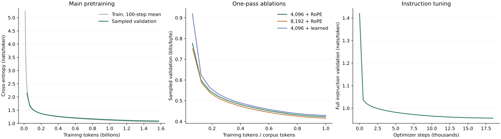

# Sprout

Sprout is a decoder-only language model trained from scratch on TinyStoriesV2-GPT4. The main model has 29,368,832 parameters: 8 layers, width 512, 8 attention heads, a 512-token context, RoPE, RMSNorm, SwiGLU, and tied embeddings. Its byte-level BPE tokenizer has 4,096 tokens, including four reserved special tokens.

The deterministic story-level split contains 537,686,596 training tokens and 5,402,089 validation tokens. Training uses AdamW, bf16 autocast on CUDA, a 300-step warmup followed by cosine decay, and 131,072 tokens per optimizer step. After 1.573 billion training tokens, the main model scores 1.091364 nats/token and 0.391208 bits/byte on complete held-out validation. Instruction tuning improves stopping to 19/20 prompts, but satisfies all requested words on only 6/20 and raises base validation loss by 11.81%; the experiment produces a story model with limited instruction following.

[Download the public model and source](https://huggingface.co/GeorgeCodesSometimes/sprout-instruct). The streaming Gradio demo runs locally; hosted deployment requires enabling Hugging Face PRO on the publishing account.

## Architecture

The dimensions and counts below are computed from `model.py` and checked against the trained checkpoint. Attention uses eight query, key, and value heads; there is no grouped-query compression, dropout, projection bias, or learned position matrix in the main model.

| Component | Shape or setting | Parameters |
| --- | --- | ---: |
| Token embedding and tied output head | 4,096 × 512; one shared matrix | 2,097,152 |
| Attention projections | 4 × 512 × 512 per layer; 8 layers | 8,388,608 |
| SwiGLU projections | 3 × 512 × 1,536 per layer; 8 layers | 18,874,368 |
| Attention and MLP RMSNorm gains | 2 × 512 per layer; 8 layers | 8,192 |
| Final RMSNorm gain | 512 | 512 |
| Total | 8 layers, width 512, 8 heads, head dimension 64 | 29,368,832 |

The context is 512 tokens, RMSNorm epsilon is `1e-5`, and the RoPE base is 10,000. The SwiGLU hidden width is 1,536 after rounding the two-thirds-of-4× expansion to a multiple of 256. RoPE tables are nonpersistent buffers, so they add no trained parameters. The output head shares the embedding tensor rather than maintaining a second vocabulary matrix. Components, causality, attention equivalence, parameter count, and one-batch overfitting are checked by `python model.py`; cached decoding has its separate `--check-cache` command.

## Data and tokenizer

Pretraining uses [TinyStoriesV2-GPT4](https://huggingface.co/datasets/roneneldan/TinyStories/tree/f54c09fd23315a6f9c86f9dc80f725de7d8f9c64), pinned in `data.py` to revision `f54c09fd23315a6f9c86f9dc80f725de7d8f9c64`. The raw file SHA-256 is `6418d412de72888f52b5142c761ac21a582f7d1166f0bfbdb5f03ccfdec90443`, verified against the local training source and upstream file metadata. The story-level split hashes each story with BLAKE2b and salt `sprout-v1-split`; hashes with residue below 100 modulo 10,000 enter validation. Identical strings always enter the same split. The prepared files contain 2,690,421 training stories and 27,074 validation stories; tokenization checks lossless decoding for every story.

`tokenizer.py` learns byte-level BPE from approximately 30 MB of training text, taking every 64th story. Unicode-aware pre-splitting keeps merges within text chunks. All 256 bytes are available before learning, avoiding an unknown-token path; ties in merge frequency resolve deterministically by token IDs. The main vocabulary consists of 256 byte tokens, 3,836 learned merges, and four atomic reserved tokens: `<|endoftext|>`, `<|user|>`, `<|assistant|>`, and `<|end|>` at IDs 4,092–4,095. Binaries store IDs as uint16 and append one end-of-story token per story.

| Tokenizer | Train tokens, including story ends | Train text bytes | Train bytes/token | Validation bytes/token |
| --- | ---: | ---: | ---: | ---: |
| 4,096 tokens | 537,686,596 | 2,164,153,281 | 4.024934 | 4.024730 |
| 8,192 tokens | 520,861,781 | 2,164,153,281 | 4.154947 | 4.154012 |

These ratios include zero-byte reserved tokens in the denominator and are computed by summing each token's decoded byte length, with reserved tokens assigned zero. They differ from the tokenizer script's printed ratio, which excludes story ends. The validation corpus contains 21,741,952 text bytes; evaluation excludes its first token and scores 21,741,948 bytes. The 4,096-token vocabulary keeps the shared embedding small for this restricted English corpus. The 8,192-token arm tests the compression/parameter tradeoff rather than assuming the smaller vocabulary is optimal.

## Training and cost

The pretrained runs share seed 1337, AdamW betas `(0.9, 0.95)`, weight decay 0.1 on matrices and zero on RMSNorm gains, gradient clipping at 1.0, and peak learning rate `1e-3`. A 300-step linear warmup precedes cosine decay to 10% of peak. Micro-batches of 64 sequences × 512 tokens accumulate four times, giving 131,072 tokens per optimizer step. CUDA uses bf16 autocast with float32 parameters and no loss scaler. Training samples windows with replacement, so a corpus-equivalent token budget is not a traversal of every story. Validation monitoring samples the same seeded windows every 250 steps; complete final evaluation is separate. Checkpoints save model, optimizer, and random-generator states every 2,000 steps and at the end.

| Run | Steps | Training budget | W&B runtime, minutes | Recorded source commit |
| --- | ---: | ---: | ---: | --- |
| Main pretraining | 12,000 | 1,572,864,000 tokens | 99.47 | `2c137fd` |
| 4,096-token RoPE baseline | 4,102 | 537,657,344 tokens | 34.83 | `2403d34` |
| 8,192-token RoPE | 3,974 | 520,880,128 tokens | 32.82 | `73072c2` |
| 4,096-token learned positions | 4,102 | 537,657,344 tokens | 32.83 | `73072c2` |
| Instruction tuning | 18,457 | 457,894,671 assistant tokens | 88.92 | `48aa20c` |

Runtimes are the `_runtime` values from the linked W&B runs, totaling 17,332 seconds (4.81 hours). They include each logged run's evaluation overhead but exclude setup and idle instance time. The main run used an A100-SXM4-40GB at a recorded rental rate of $0.406/hour: its runtime implies approximately $0.67 in compute. Applying that same rate to all five runs would imply approximately $1.95; that is an estimate, not an invoice or a verified rate for the later jobs. Total billed cost, storage charges, rehearsal, and idle time have not been verified. The project's $30 target is a budget, not a measured total cost.

## Runs

| Run | Training tokens | Full validation cross-entropy | Bits per byte | Training record |
| --- | ---: | ---: | ---: | --- |
| Main pretraining, 12,000 steps | 1,572,864,000 | 1.091364 | 0.391208 | [W&B](https://wandb.ai/george-nasseem/sprout/runs/y5ye7t4k) |
| One-pass 4,096-token RoPE baseline, 4,102 steps | 537,657,344 | 1.180857 | 0.423287 | [W&B](https://wandb.ai/george-nasseem/sprout/runs/i0wis53q) |
| One-pass 8,192-token RoPE, 3,974 steps | 520,880,128 | 1.202189 | 0.417522 | [W&B](https://wandb.ai/george-nasseem/sprout/runs/yf7r4ema) |
| One-pass 4,096-token learned positions, 4,102 steps | 537,657,344 | 1.196941 | 0.429052 | [W&B](https://wandb.ai/george-nasseem/sprout/runs/ul3wfup5) |

Validation scores were recomputed with `eval.py` on October 8, 2026 using PyTorch 2.14.0, MPS, float32, and batches of 8. The original CUDA summaries used bf16 and excluded the final partial validation window; those historical numbers differ slightly. All rows above use the same complete scoring policy.

The baseline finished on October 7, 2026; both other arms finished on October 8. All final checkpoints are verified locally and in the private [checkpoint repository](https://huggingface.co/GeorgeCodesSometimes/sprout-checkpoints): `ckpt.pt` for the main model, and `base/ckpt.pt`, `vocab8192/ckpt.pt`, and `learned-pos/ckpt.pt` for the controlled runs. Cross-entropies should not be compared across tokenizers; the vocabulary comparison uses bits per byte over the same held-out stories.

Each controlled arm has a training-token budget approximately equal to one pass through the same raw stories; batches are random windows sampled with replacement. The 8,192-token arm needs fewer steps because its tokenizer compresses the text differently. All three use seed 1337, 131,072 tokens per optimizer step, a 300-step warmup, peak learning rate 1e-3, and cosine decay over the arm's step count. The main model trains for about 2.93 corpus passes and is outside this controlled comparison.

The larger vocabulary lowers full-validation bits per byte by 1.36%, and its sampled curve stays below the baseline throughout training. It also increases parameters from 29,368,832 to 31,465,984 (7.14%) and uses fewer optimizer steps: this comparison matches the text budget, not parameter count or compute, and uses one seed.

Learned absolute positions raise full-validation bits per byte by 1.36%; their sampled curve stays above RoPE throughout training. The tokenizer and optimizer schedule match, with 262,144 additional position-embedding parameters. This result favors RoPE at the one-pass budget; a longer run or different seed could change the comparison.

## Loss curves



Main pretraining shows a 100-step trailing mean of all 12,000 training losses and 48 sampled-validation points. The ablations plot sampled bits per byte against training tokens divided by each tokenizer's corpus length, so one unit is approximately one text-budget equivalent. Instruction tuning shows 38 full-validation measurements, including the initial checkpoint and final step. Curves are reconstructed from the existing training logs; the [main](https://wandb.ai/george-nasseem/sprout/runs/y5ye7t4k), [baseline](https://wandb.ai/george-nasseem/sprout/runs/i0wis53q), [larger vocabulary](https://wandb.ai/george-nasseem/sprout/runs/yf7r4ema), [learned positions](https://wandb.ai/george-nasseem/sprout/runs/ul3wfup5), and [instruction tuning](https://wandb.ai/george-nasseem/sprout/runs/rb9ndxvw) runs retain the original measurements. Sampled curve endpoints differ slightly from the complete, uniform evaluation reported in the table above.

## Evaluate

`eval.py` loads the checkpoint's architecture, verifies its data/tokenizer fingerprint, and scores consecutive windows of its context length (512 tokens here), including the final partial window. Every token after the first is a target; end-of-story tokens contribute loss and zero text bytes. Both tokenizers cover the same 21,741,948 scored text bytes. Cross-entropy is in nats per token; bits per byte is total negative log-likelihood divided by `ln(2)` and the scored text bytes.

```bash
python eval.py checkpoints/main/ckpt.pt > checkpoints/main/eval.txt
python eval.py checkpoints/base/ckpt.pt > checkpoints/base/eval.txt
python eval.py checkpoints/vocab8192/ckpt.pt --data data/vocab8192 > checkpoints/vocab8192/eval.txt
python eval.py checkpoints/learned-pos/ckpt.pt > checkpoints/learned-pos/eval.txt
```

Each output includes checkpoint SHA-256, training config, data fingerprint, device/precision, validation scores, and all 20 unedited continuations. Sampling uses temperature 0.8, top-k 50, at most 256 new tokens, and seeds 1337–1356, with an end-of-story token before each opening. Every sample records its settings, generated token IDs, and whether it ended or hit the limit. The first sample is generated twice and must match exactly. Seeds reproduce samples on the same software/device; floating-point differences can change samples across devices.

The main model emits the end-of-story token on 17 of the 20 openings before the token limit. Fluent sentences still lose story facts:

- Opening 2 repeats: “You can wear it on your finger or on your finger.”
- Opening 16 starts with Sam's boat sinking, then treats the heavy stone as a way to make the boat faster.
- Opening 20 changes Rose's name to Lily while describing the marble. The one-pass baseline also drifts from Rose to Rosie and Rosely on this opening.
- The 8,192-token model's opening 2 calls a squirrel a bird and has it fly onto Lily's shoulder. Lower bits per byte does not establish better story quality on this ungraded suite.

These are examples from the fixed suite, not a scored quality benchmark. The complete outputs retain successful stories and failures alike.

A base-model continuation illustrates both fluency and inconsistency. On opening 7, “A tiny dragon could only blow bubbles instead of fire,” the main model begins:

> He was only three years old. He was walking with his mom and saw many different kinds of bubbles. He wanted to try them all.

Later the same continuation says the dragon cannot blow bubbles, contradicting the opening. This is the saved `eval.py` output with seed 1343, temperature 0.8, top-k 50, at most 256 new tokens, and successful end-of-story stopping; the excerpt is unedited.

## Instruction tuning

`sft.py` prepares [TinyStoriesInstruct](https://huggingface.co/datasets/roneneldan/TinyStoriesInstruct/tree/ee050ed1f8720795be342921335e821856a2b42e), trains the pretrained model with assistant-only loss, and evaluates word inclusion, exact sentence inclusion, stopping, and base-model validation regression. The first full run completed on October 9, 2026: one shuffled epoch, 18,457 optimizer steps, 2,362,399 conversations, and 457,894,671 supervised assistant tokens. The finished [W&B run](https://wandb.ai/george-nasseem/sprout/runs/rb9ndxvw) records commit `48aa20c` and 5,335 seconds of runtime (about 89 minutes).

The exact conversation is `"<|user|>\n{instruction}<|end|>\n<|assistant|>\n{story}<|end|>"`. The instruction starts with `"Write a short story.\n"`, followed by the available `Summary:`, `Words:`, `Random sentence:`, and `Features:` lines in that order, with no trailing newline. `prompt()` produces the identical prefix for training and generation. Labels ignore the prompt and right padding; the last prompt position predicts the first assistant token, and the assistant's final `<|end|>` is supervised. Causal attention prevents right padding from influencing real tokens.

Preparation pins the source revision, parses metadata on either side of `Story:`, and removes malformed records, reserved-token content, and whitespace-equivalent duplicate stories. The official instruction validation stories are excluded from instruction training, as are stories in the existing base validation split. Complete conversations longer than 512 prediction positions are excluded rather than teaching an artificial early ending. This favors shorter stories. Validation preparation retained 23,833 of 25,027 records (4,592,270 assistant tokens); it excluded 34 malformed records, 1,019 over-context records, and 141 duplicates or base-validation overlaps. Training preparation excluded 3,458 malformed records, 97,915 over-context records, and 12,761 duplicates or validation overlaps from 2,476,533 source records.

Run on the CUDA machine with the existing data and main checkpoint available; preparation needs space for the 2.66 GB source and its tokenized copy. Also copy `data/val.jsonl` from the original split to the machine: it is required to exclude base-validation stories and is absent from the prepared-data Hub repository.

```bash
python sft.py --prepare
python sft.py --check
python sft.py --checkpoint checkpoints/main/ckpt.pt --evaluate --micro-batch 8 > checkpoints/main/instruct-eval.txt
python sft.py --checkpoint checkpoints/main/ckpt.pt --hub GeorgeCodesSometimes/sprout-checkpoints
python sft.py --checkpoint checkpoints/sft/best.pt --evaluate --micro-batch 8 > checkpoints/sft/instruct-eval.txt
```

The default is one shuffled epoch, seed 1337, learning rate 3e-5, up to 100 warmup steps, cosine decay to 10% of peak, AdamW with weight decay 0.1 and betas (0.9, 0.95), gradient clipping at 1.0, and 16 sequences × 8 accumulation batches. Accumulation is weighted by assistant tokens, including the final partial batch. Full instruction validation runs before training, every 500 steps, and at epoch boundaries. W&B records losses, gradients, learning rate, throughput, configuration, and Git commit. `best.pt` selects the lowest instruction validation loss; `ckpt.pt` holds the latest optimizer and RNG state. Both upload to the private checkpoint repository's `sft/` directory when `--hub` is supplied. Use the same training command with `--resume` to continue; source checkpoint and prepared-data hashes must match. `--no-wandb` and an omitted `--hub` support local checks.

Evaluation uses the first 20 valid, in-context official validation records containing both words and a sentence constraint, with fixed seeds 1337–1356, temperature 0.8, and top-k 50. Generation stays within the trained context so the instruction remains visible. Outputs retain all token IDs, full continuations, settings, case-insensitive whole-word inclusion, exact sentence inclusion, and whether `<|end|>` was emitted. Run base and tuned evaluation on the same device and precision; compare full base validation loss as well as instruction metrics. Summary fidelity still requires reading the continuations.

On October 9, both models were evaluated on CUDA with PyTorch `2.11.0+cu128`, bf16 autocast, and batches of 8, using the identical 20 prompts and sampling settings:

| Metric | Pretrained main model | Instruction-tuned model |
| --- | ---: | ---: |
| All requested words included | 0/20 | 6/20 |
| Exact requested sentence included | 1/20 | 4/20 |
| Assistant `<\|end\|>` emitted | 0/20 | 19/20 |
| Full base-validation loss, nats/token | 1.091467 | 1.220414 |
| Full base-validation bits per byte | 0.391245 | 0.437467 |

Instruction validation loss fell from 1.419628 before tuning to 0.956147 at step 18,457, which is both the final and best checkpoint. Stopping improved strongly, but most word and sentence constraints still fail. Base-validation loss rose by 11.81%; this run demonstrates a tradeoff rather than reliable instruction following. The CUDA baseline differs slightly from the earlier MPS float32 evaluation, which scored 0/20 on all three behavioral metrics; comparisons above use the matching CUDA evaluation.

Complete outputs are retained locally in `checkpoints/main/instruct-eval-cuda.txt` and `checkpoints/sft/instruct-eval.txt`, with preparation and training logs in `checkpoints/sft-prepare.txt`, `checkpoints/sft.log`, and `checkpoints/sft/losses.txt`. Both local checkpoints match the SHA-256 hashes of `sft/best.pt` and `sft/ckpt.pt` in the private [checkpoint repository](https://huggingface.co/GeorgeCodesSometimes/sprout-checkpoints). The best checkpoint also loads with the original tokenizer/data fingerprint and generates on CPU. The inference weights and source are published in [sprout-instruct](https://huggingface.co/GeorgeCodesSometimes/sprout-instruct). The local streaming demo is implemented; hosted Space creation is awaiting the publishing account’s PRO subscription.

The inline checks verify the shifted masking boundary, final end label, zero logit gradients at ignored positions, unequal-length accumulation, and Unicode template round-trip. A local three-step training run with a partial final batch reproduced exactly after save/resume. A CPU update of the main pretrained checkpoint reduced a held-out smoke example's loss from 0.977750 to 0.703327; those temporary weights were discarded.

The tuned model's prompt 20 asks for `try, window, furry` and the exact sentence “The cat liked to look out the window and watch the birds fly by.” Its full saved continuation is:

> Once upon a time, there was a little furry cat. The cat liked to look out the window and watch the birds fly by. One day, the cat wanted to play with the birds, but they were too high up in the sky. The cat tried to jump up and reach them, but it couldn't. The cat felt sad and went back to the window. The sun was shining and the birds flew away. The cat watched them from the window and felt happy again. The end.

This output uses seed 1356, temperature 0.8, top-k 50, a 439-token context-preserving limit, and assistant-end stopping on CUDA bf16. It includes the sentence, `window`, and `furry`, but uses `tried` instead of the required whole word `try`. Passing one visible constraint does not mean all constraints passed. Prompt 1 is a stronger failure: its flower summary becomes a treasure-and-police-car story, identifies Ben as the children's mother, and reaches the token limit. Prompt 5 includes all three words and the sentence “The end.” yet still drifts from the requested summary. The evaluation measures literal constraints and stopping, not a graded summary-fidelity score.

## Cached generation

`model.generate()` uses a KV cache by default; `use_cache=False` runs the full-prefix reference. Set `temperature=0` for greedy decoding. `model.generate_tokens()` yields one `(batch, 1)` token tensor at a time for streaming. Each iterator owns its cache, and finished batch rows emit only the stop token while the other rows continue.

`model.forward_cached(tokens, cache=None)` returns chunk logits and a tuple of per-layer `(K, V)` tensors, each shaped `(batch, heads, cached_tokens, head_dim)`. RoPE and learned positions start at the cached prefix length, and multi-token chunks use an offset causal mask. Caching requires `model.eval()` and runs without gradients. Training and checkpoint weights use the same format as before.

At the 512-token context limit, generation rebuilds the cache from the last 512 tokens at position zero. Simply dropping the oldest keys would retain hidden states from a different context and change predictions. This rebuild matches uncached sliding-window generation but loses the speedup once the window is full. Instruction generation already limits the continuation to keep the complete prompt visible.

```bash
python model.py --check-cache --device cpu
python model.py --check-cache --device mps
```

The checks passed on CPU and MPS and cover 224 exact greedy token matches for both position encodings, context rollover, chunk logits, streaming, and batched stopping. The main pretrained checkpoint also matched 256 greedy tokens exactly on both devices in float32, plus 24 tokens from a 500-token prefix across rollover on CPU. On this laptop with four CPU threads, the 256-token run took 6.234 seconds uncached and 1.779 seconds cached (3.50× faster).

## Portable inference and demo

Use the published files directly, without training or private repository access:

```bash
python -m venv .venv
source .venv/bin/activate
python -m pip install huggingface_hub
hf download GeorgeCodesSometimes/sprout-instruct --local-dir sprout
cd sprout
python -m pip install -r requirements.txt
python app.py
```


Export the best instruction checkpoint into a new, empty directory and run the CPU demo:

```bash
python -m pip install -r requirements.txt
python export.py --checkpoint checkpoints/sft/best.pt --out checkpoints/release
python app.py --model checkpoints/release
```

Open `http://127.0.0.1:7860`. The model loads once at startup; requests stream plain text through its KV cache. Story idea, words, sentence, and features use the exact training template shared with `sft.py`. Temperature, top-k, a generation limit, and cancellation are exposed. Requests run serially with a bounded queue. Empty fields, reserved-token injection, and oversized instructions produce actionable errors; instructions remain visible throughout generation. UTF-8 byte fragments are buffered until a character is complete.

`export.py` verifies the checkpoint/data fingerprint before writing float32 safetensors, architecture and checksum configuration, the original tokenizer merges, the inference source files, dependencies, license, and model card. Optimizer state and training data are excluded. The tied embedding/output weight is stored once and restored as a shared tensor. The export checks 64 exact greedy continuation tokens against the checkpoint. The default weights occupy 117,482,344 bytes.

The whole bundle can be copied to a machine without the training files. From inside that copied directory:

```python
from inference import load, stream

model, tok, config = load(".")
for text in stream(model, tok, {"Summary": "A fox finds a seed."}):
    print(text, end="\r", flush=True)
```

`load` also accepts a Hugging Face model ID with an optional `revision` commit. It downloads only weights, configuration, and tokenizer files, verifies both SHA-256 checksums, and uses the included local Python implementation. This is a custom PyTorch loading contract, not a Transformers `AutoModel` integration. See the [Hub upload documentation](https://huggingface.co/docs/hub/models-uploading) and [safetensors tied-weight documentation](https://huggingface.co/docs/safetensors/torch_shared_tensors).

The published model is [GeorgeCodesSometimes/sprout-instruct](https://huggingface.co/GeorgeCodesSometimes/sprout-instruct). For subsequent model releases, upload the exported directory with its generated `README.md`. For a Gradio Space, upload the same files but use `SPACE.md` as the Space's `README.md`; its frontmatter pins Gradio 6.30.0 and Python 3.11. The app honors Gradio's server-address environment setting; `python app.py --host 0.0.0.0` supports other containers. The [Spaces runtime](https://huggingface.co/docs/hub/spaces-sdks-gradio) installs the listed dependencies and runs `app.py`. No upload is performed by the export or demo commands.

On October 9, 2026, an isolated, freshly installed environment with PyTorch 2.14.1 and Gradio 6.30.0 loaded the copied bundle offline, generated and streamed on CPU, built the queued demo, and rejected a modified tokenizer. Browser generation and cancellation passed at 1440-pixel desktop and 390-pixel mobile widths without horizontal overflow. HTTP checks covered omitted optional fields, Unicode and nonsense prompts, and actionable errors for empty, injected, and oversized inputs. The existing template/masking checks also passed after sharing the prompt implementation. The public model was also downloaded anonymously into a new directory and loaded in a freshly installed environment without corpus files or cached credentials; CPU streaming and tied-weight restoration passed. Hosted Space creation returned HTTP 402: [Gradio/Docker Spaces on CPU Basic require a paid plan](https://huggingface.co/docs/hub/spaces-overview). The remaining deployment action is to enable PRO on the publishing account, then upload the prepared Space bundle and verify hosted streaming.

## Limitations and future work

All comparisons use one seed. The vocabulary arm changes parameter count, compression, and number of updates; the learned-position arm adds a position matrix. The longer main run is not part of the controlled one-pass comparison. The fixed generation suites contain 20 examples each, so their literal constraint counts cannot establish broad reliability. Synthetic English stories cover a narrow domain; the model has no general chat or factual-answering capability, no content filter, and no suitability evaluation for children. Excluding over-context instruction conversations favors short stories. Instruction loss improves while base loss regresses, and better end-token behavior does not solve constraint or narrative fidelity.

The next modeling experiment should compare an earlier instruction checkpoint and a lower update budget on the same held-out prompts, measuring both constraint success and base-loss regression before spending on a larger model. Additional seeds and a scored summary-fidelity suite would address uncertainty in the current results. No result here demonstrates performance beyond the trained 512-token context.

[Multi-head Latent Attention, introduced in DeepSeek-V2](https://arxiv.org/abs/2405.04434), caches a joint low-rank representation of keys and values, with separate handling of positional information, instead of storing each head's full key/value tensors. For Sprout, a full batch-one cache is `2 × 8 layers × 512 tokens × 512 dimensions`: 8 MiB in bf16 or 16 MiB in the float32 CPU demo. Those numbers are calculated from the implemented tensor shapes, not measured process memory. At 29.4M parameters and this short context, changing the attention architecture and retraining would add substantial complexity to save a small cache; retaining verified ordinary attention is the practical choice here. MLA becomes a more relevant experiment if long contexts or large simultaneous batches make cache memory a measured bottleneck.

Code and exported weights use the repository's MIT license. The upstream TinyStories card lists CDLA-Sharing-1.0; source data provenance and limitations are retained in the model card. The public model repository includes the training and evaluation source needed for reproduction. Corpus and optimizer-state repositories remain private; they are optional shortcuts and are not required to regenerate data and train from scratch.

## Reproduce

Use Python 3.11 or later. Download the public model repository as above, which includes the flat Python source files, or use the Git checkout. Install `torch numpy regex huggingface_hub wandb`; select a CUDA-compatible PyTorch build for GPU training. The original training/evaluation ran with PyTorch `2.11.0+cu128` and the independent local evaluations used PyTorch 2.14.0 float32. Later software or devices can change sampled text even at a fixed seed.

Prepare the pinned raw source, deterministic split, and both vocabularies:

```bash
python data.py
python tokenizer.py
python tokenizer.py 8192
python model.py --device cuda
python train.py --check
```

Train the main model and all three comparison arms independently with their full cosine schedules:

```bash
python train.py --out checkpoints/main --steps 12000 --no-wandb
python train.py --out checkpoints/base --steps 4102 --no-wandb
python train.py --out checkpoints/vocab8192 --data data/vocab8192 --steps 3974 --no-wandb
python train.py --out checkpoints/learned-pos --pos learned --steps 4102 --no-wandb
```

Omit `--no-wandb` to log under your own account. Add `--hub YOUR_ACCOUNT/YOUR_REPO` to upload checkpoints to a repository you control. A local `--resume` restores the saved optimizer and RNG state; use the same architecture, data, step budget, and schedule. Continuing a W&B run also requires its original `WANDB_RUN_ID`.

Instruction preparation uses the generated `data/val.jsonl` to exclude base-validation stories; keep that file. The following commands train the one-epoch tuned checkpoint and reproduce the matching CUDA evaluation:

```bash
python sft.py --prepare
python sft.py --check
python sft.py --checkpoint checkpoints/main/ckpt.pt --out checkpoints/sft --no-wandb
python sft.py --checkpoint checkpoints/main/ckpt.pt --evaluate --device cuda --micro-batch 8
python sft.py --checkpoint checkpoints/sft/best.pt --evaluate --device cuda --micro-batch 8
```

Run `eval.py` for complete base validation and the fixed base generation suite, using the commands in the evaluation section. Export the best instruction checkpoint and launch `app.py` with the commands in the portable-inference section. Full training does not require access to the private prepared-data or checkpoint repositories.
